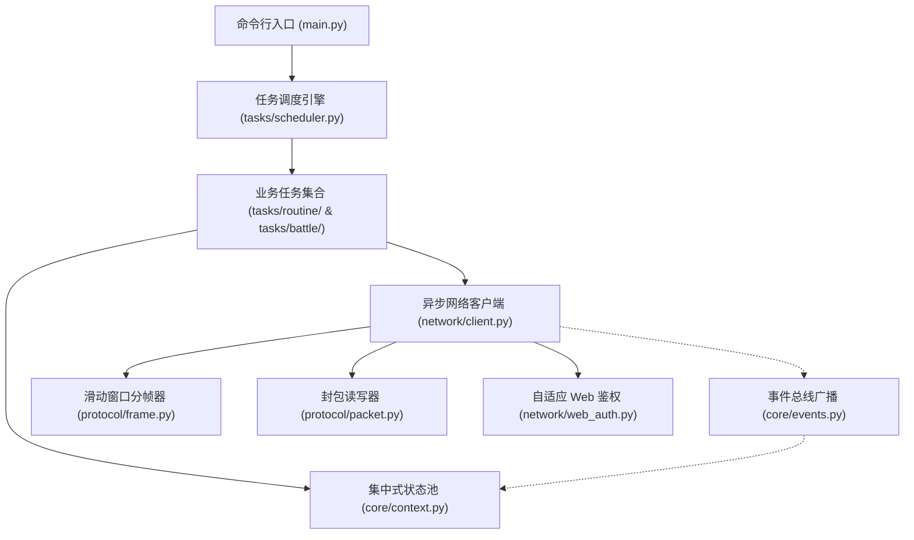
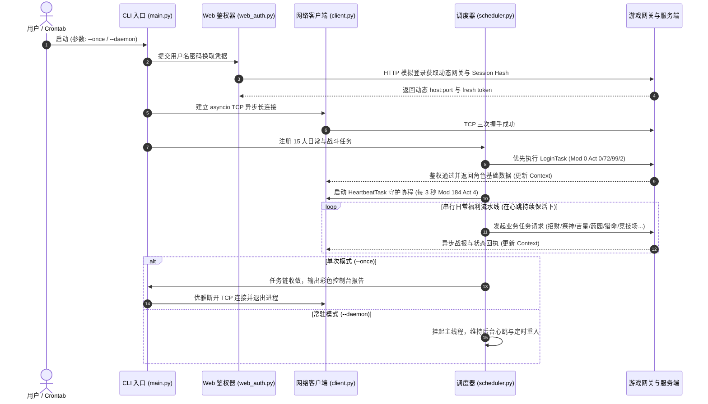

# 神仙道无头协议自动化架构与生命周期指南 (Pipeline & Lifecycle)

本文档阐述神仙道无头自动化工具（SXD Bot）的分层架构模型、端到端执行流水线以及任务调度生命周期。

---

## 1. 系统分层架构模型

系统严格分为四层解耦架构，保证网络通信、状态存储与业务逻辑单向依赖：

1. **协议层 (`protocol/`)**：管理 4 字节大端整数长度分帧、RFC 1950 zlib 压缩解压以及 Flash ByteArray 读写器；
2. **网络通信层 (`network/`)**：负责维持持久化 TCP 长连接、串行指令发送队列以及请求-响应 Future 匹配；
3. **状态与事件层 (`core/`)**：集中存储玩家角色财富、背包与场景状态，通过事件总线进行广播；
4. **任务调度层 (`tasks/`)**：提供统一的 `BaseTask` 抽象、超时控制、前置守卫与周期协程调度。

---

## 2. 运行时完整生命周期流水线

机器人启动后，从凭据嗅探到任务收敛退出的完整执行路径如下图所示：

---

## 3. 核心机制与设计准则

### 3.1 零元宝安全熔断准则 (Zero-Ingot Guardrail)

所有业务任务在构造发包前，必须实施客户端前置熔断防御：
- **招财神符**：仅当免费次数 `> 0` 时发包；
- **帮派祭神**：强制锁定香种参数为 `1`（白檀香，仅消耗微量铜钱）；
- **世界 Boss / 精英副本**：阵亡仅使用免费复活，坚决不扣元宝秒冷却；
- 详见架构决策记录：[0004 零元宝安全熔断机制与前置卫语句跳过策略](../adr/0004-zero-ingot-guardrail-and-fail-fast-skipping.md)。

### 3.2 前置卫语句与快速跳过 (Fail-Fast Skipping)

针对存在等级门槛（如仙履奇缘 28 级、取经 40 级）或时段限制（多人副本 12:30/18:30、世界 Boss 10:00/15:30）的功能，任务执行前主动判定当前环境：
- 若条件不满足，立即返回 `TaskResult.skipped(reason)`；
- 坚决杜绝在非活动时段向服务端发送探测指令，规避服务端网关判定异常主动切断长连接（EOF 断开）。

### 3.3 领域术语统一维护

代码与技术文档必须遵循项目根目录统一语言约束：
- 严格使用官方规范行话，排斥非标准代称；
- 详见领域统一模型：[CONTEXT.md](../../CONTEXT.md)。

### 3.4 逆向协议速查矩阵

针对具体 Mod / Act 编号、字节序定义与载荷结构：
- 详见协议速查矩阵：[mod_action_matrix.md](../protocol/mod_action_matrix.md)。
