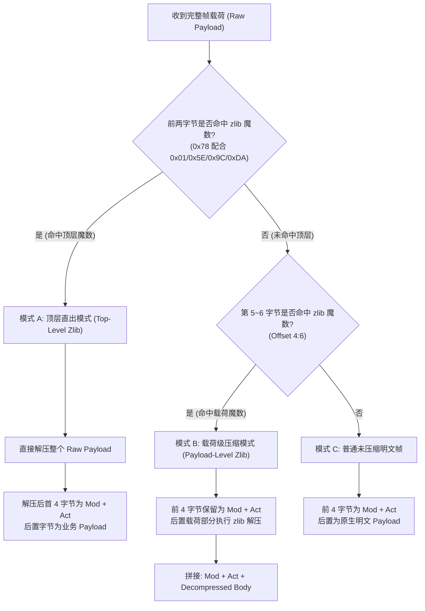

# 传输层物理切帧与基础类型编解码体系规范 (Framing & Primitives Codec Spec)

本文档定义了神仙道微端与游戏服务端之间的底层传输层物理帧封装格式、粘包/半包滑动切分算法、双模式 RFC 1950 zlib 解密探测机制以及官方 10 种基础序列化类型的映射标准。

---

## 1. 传输层物理帧封装格式 (Frame Physical Layout)

所有在 TCP 长连接中双向流转的逻辑业务封包，在进入传输层前必须封装为标准的统一物理帧：

```text
+-------------------+------------------+------------------+-------------------------+
| 4 Bytes Length    | 2 Bytes Mod      | 2 Bytes Act      | N Bytes Body Payload    |
| (Big-Endian UInt) | (Big-Endian U16) | (Big-Endian U16) | (Flash ByteArray / zlib)|
+-------------------+------------------+------------------+-------------------------+
|<----------------- 完整物理数据帧 (Total Frame Length = 4 + Length) ----------------->|
```

### 1.1 字段定义与端序规范
- **Length (4 字节大端整数, `>I`)**：表示后续字节总数，计算公式为：
  $$\text{Length} = \text{len}(\text{Mod}) + \text{len}(\text{Act}) + \text{len}(\text{Payload}) = 4 + N$$
  传输层帧总长为 $4 + \text{Length}$ 字节。
- **Mod (2 字节大端短整数, `>H`)**：官方业务功能模块编号（对应 ActionScript 中的 `com.protocols::Mod_XXX_Base`，如 `Mod 0` 为角色模块，`Mod 1` 为城镇模块）。
- **Act (2 字节大端短整数, `>H`)**：模块内部细分子指令编号（如 `Mod 0` 的 `Act 0` 为 `login`，`Act 72` 为 `init_client`）。
- **Body Payload (N 字节业务载荷)**：遵循 Flash `ByteArray` 大端规范序列化的参数列表。

---

## 2. 连续多帧聚合与粘包处理机制 (Pipelined Multi-Frame Slicing)

实测网络抓包（如微端启动首个 TCP 会话 Turn 1）表明：**客户端与服务端在单个 TCP 报文中频繁连续聚合多个独立 Frame**。

### 2.1 真实粘包切片范例
在客户端发送登录请求的第一个 TCP 包中（总长 120 字节），紧密粘连了两帧数据：
```text
[Frame 1: 108 字节] 00000068 (Length=104B) + 0000 (Mod 0) + 0000 (Act 0: login) + 100B Payload
[Frame 2:  12 字节] 00000008 (Length=8B)   + 0000 (Mod 0) + 0048 (Act 72: init_client) + 4B Payload
```
接收端若假定“一次套接字读取对应一帧数据”，将直接遗漏第二帧 `init_client`，导致服务端握手状态停滞。

### 2.2 滑动窗口切片状态机算法
解码器必须基于环形或动态缓冲区维护滑动切片逻辑：
1. **长度校验**：当缓冲区长度 $\ge 4$ 字节时，读取首部 4 字节无符号整数 `payload_len`。
2. **容错对齐**：
   - 若 `payload_len == 0`，视为空保活心跳，前向滑动 4 字节。
   - 若 `payload_len > 2 \text{MB}`，视为同步字节偏移异常，前向滑动 1 字节并重试匹配。
3. **半包挂起**：若缓冲区长度 $< 4 + \text{payload_len}$，表明当前帧字节尚未完整到达，挂起等待后续网络碎片。
4. **完整切帧**：截取索引 $[4, 4 + \text{payload_len}]$ 对应的切片，从缓冲区弹出，转入 zlib 探测与反序列化管道。

---

## 3. 双模式 RFC 1950 zlib 压缩自适应解密 (Dual-Mode Zlib Stream)

神仙道服务端对大载荷广播（如活动结算、系统公告、玩家全量数据）实施了动态 zlib 压缩。实测抓包证实存在**两种不同的压缩封装形态**：



### 3.1 模式 A：顶层直出压缩 (Top-Level Zlib Push)
- **特征**：帧长度之后直接紧跟 `0x78 0x9c`（RFC 1950 压缩签名）。
- **结构**：`[4B Length] + [zlib Stream (包含 2B Mod + 2B Act + Body)]`
- **处理**：状态机直接调用 `zlib.decompress()` 解压，解压后展开为包含 Mod 与 Act 的二级标准二进制流。

### 3.2 模式 B：载荷级压缩 (Payload-Level Zlib)
- **特征**：前 4 字节为明文的 Mod 与 Act，从第 5 字节开始命中 `0x78` 签名。
- **结构**：`[4B Length] + [2B Mod] + [2B Act] + [zlib Stream (仅压缩 Body)]`
- **处理**：保留首部 4 字节 `Mod + Act`，仅将后置载荷进行 `zlib.decompress()` 解压并与首部拼接。

---

## 4. 官方 10 种基础序列化类型契约 (Primitive Types Specification)

在游戏客户端核心源码中，所有字段序列化方法均由 `com.haloer.utils::Utils` 提供。以下为各基础类型的精确物理排版：

| 官方工具类名 | 逻辑类型 | 物理长度 | 端序与编码格式 | 读取器方法 | 写入器方法 | 业务场景与示例 |
| :--- | :--- | :--- | :--- | :--- | :--- | :--- |
| `BooleanUtil` | `bool` | 1 字节 | `0x00=false`, `0x01=true` | `read_bool()` | `write_bool(v)` | 开关标志、是否已签到、功能是否开启 |
| `ByteUtil` | `int8` | 1 字节 | 8 位带符号整数 (`>b`, -128 ~ 127) | `read_int8()` | `write_int8(v)` | 阵营编号 (CampId)、枚举项索引 |
| `UByteUtil` | `uint8` | 1 字节 | 8 位无符号整数 (`>B`, 0 ~ 255) | `read_uint8()` | `write_uint8(v)` | 状态响应码 (0=成功)、香火类型档位 |
| `ShortUtil` | `int16` | 2 字节 | 16 位大端带符号整数 (`>h`) | `read_int16()` | `write_int16(v)` | 相对坐标偏移、已签到天数 |
| `IntUtil` | `int32` | 4 字节 | 32 位大端带符号整数 (`>i`) | `read_int32()` | `write_int32(v)` | 角色等级、元宝数、城镇编号、怪物 ID |
| `LongUtil` | `int64` | 8 字节 | 64 位大端带符号长整数 (`>q`) | `read_int64()` | `write_int64(v)` | 铜钱余额 (Coins)、生命值、经验值上限 |
| `FloatUtil` | `float32` | 4 字节 | 32 位大端 IEEE 754 浮点数 (`>f`) | `read_float()` | `write_float(v)` | 缩放比例、战斗伤害乘数 |
| `DoubleUtil` | `float64` | 8 字节 | 64 位大端 IEEE 754 双精度 (`>d`) | `read_double()` | `write_double(v)` | 高精度浮点时间戳、活动进度权重 |
| `StringUtil` | `string` | 动态 | 2B 大端长度前缀 (`>H`) + UTF-8 字节串 | `read_utf()` | `write_utf(v)` | 玩家昵称 (Nickname)、鉴权 Token、平台名 |
| `JSONUtil` | `json` | 动态 | 2B 大端长度前缀 (`>H`) + UTF-8 JSON 文本 | `read_json()` | `write_json(v)` | 复合扩展配置、战报时序序列化字典 |

---

## 5. 真实抓包十六进制报文黄金向量对照 (Golden Vectors)

以下提取自真实抓包切片中的实际报文，作为二次开发实现编解码器的回归测试基准：

### 5.1 登录握手复合帧 (Stream 18 Turn 1)
```text
Hex Raw (120 Bytes):
000000680000000000066b6f6e6779750020623437373635393362623834386537623634
6638386139386465623431613863000a31373932303635333835000966656e6777616e79
7800000000000062b40160000006e796afe78ea9000570635f77640100066b6f6e677975
000000080000004800000000
```
- **第 1 帧切片拆解**：
  - `00000068`: Length = 104 字节
  - `0000`: Mod = 0 (`Mod_Player_Base`)
  - `0000`: Act = 0 (`login`)
  - `0006 6b6f6e677975`: StringUtil = `"kongyu"`
  - `0020 623437...`: StringUtil = `"b4776593bb848e7b64f88a98deb41a8c"` (32位 Token)
  - `000a 3137...`: StringUtil = `"1792065385"` (时间戳)
  - `0009 6665...`: StringUtil = `"fengwanyx"` (平台)
  - `00000000`: IntUtil = `0`
  - `000062b4`: IntUtil = `25268` (大区服务器编号 ServerId)
  - `0005 70635f7764`: StringUtil = `"pc_wd"` (微端特征标识)
- **第 2 帧切片拆解**：
  - `00000008`: Length = 8 字节
  - `0000`: Mod = 0 (`Mod_Player_Base`)
  - `0048`: Act = 72 (`init_client`)
  - `00000000`: IntUtil = `0` (初始化标识)

### 5.2 登录成功回执帧 (Stream 18 Turn 2)
```text
Hex Raw (30 Bytes):
0000001a0000000000000000040a000000000000000001000b0000108501
```
- `0000001a`: Length = 26 字节
- `0000`: Mod = 0 (`Mod_Player_Base`)
- `0000`: Act = 0 (`login_resp`)
- 官方 AVM2 字节码反编译契约 (`Mod_Player_Base.login.response`) 对应 10 个基础类型字段：
  1. `00`: `UByteUtil` = `0` (登录状态码 0: 成功)
  2. `00000004`: `IntUtil` = `4`
  3. `0a`: `UByteUtil` = `10`
  4. `00000000`: `IntUtil` = `0`
  5. `00`: `ByteUtil` = `0`
  6. `00000001`: `IntUtil` = `1`
  7. `00`: `ByteUtil` = `0`
  8. `0b`: `UByteUtil` = `11`
  9. `00001085`: `IntUtil` = `4229` (微端首绑礼包 ID)
  10. `01`: `ByteUtil` = `1` (客户端特性标识)

---

## 6. 二次开发与语言绑定指引 (Binding Guide)

在进行二次开发或跨语言移植时：
1. **端序统一**：所有多字节整数、浮点数以及字符串长度前缀必须采用**网络字节序（大端序, Big-Endian）**。
2. **切片先于解压**：必须先从 TCP 流中按照首部 4 字节完整截断出一个 Frame，再送入解压缩与反序列化逻辑，严禁在未完整切帧前对字节流进行跨边界解压。
3. **零分配防御**：当反序列化 `StringUtil` 长度异常超过 `65,535` 字节或 Frame 长度超过 `2MB` 时，应立即前置熔断并抛出异常，防止恶意或错位字节导致内存暴涨。
