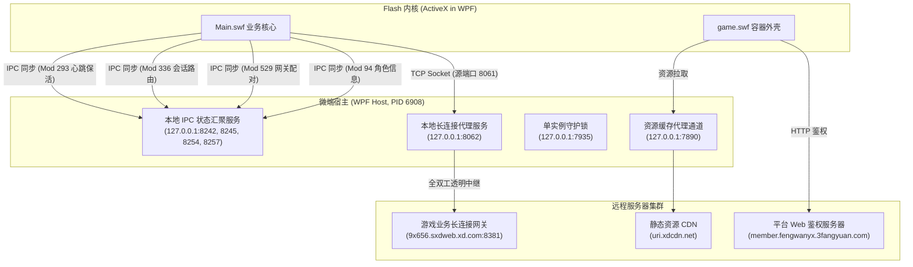
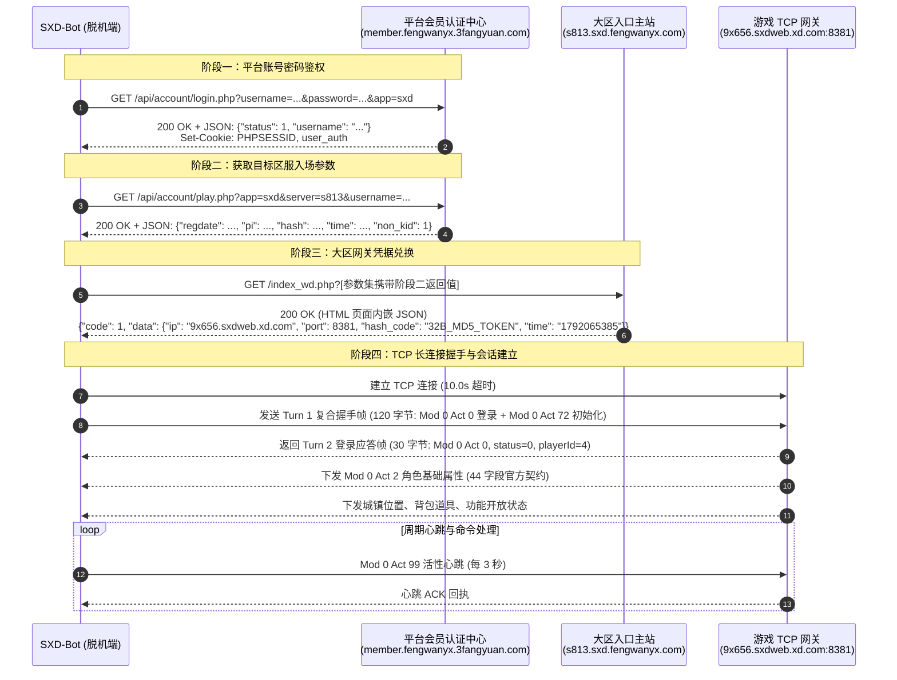

# 微端程序架构、Flash OCX 宿主机制与本地双端口代理中继规约

> **文档状态**：已冻结 (Frozen)  
> **面向对象**：二次开发团队、无头协议机器人开发者、脱机客户端架构师  
> **关联工单**：[Ticket 2: 微端 .NET WPF 宿主、Flash OCX 嵌入机制与本地双端口代理中继解密](https://github.com/atengk/sxd-bot/issues/3)  
> **上游规约**：[00_binary_framing_and_codecs.md](./00_binary_framing_and_codecs.md)

---

## 1. 微端架构与单文件宿主解压生命周期

神仙道官方桌面微端（例如 `sxd_wd_V3.11_1693793577.exe`）是一款基于 **.NET WPF** 框架构建的单文件自解压与运行时引导宿主程序。由于微软自 Windows 10/11 淘汰系统级 Adobe Flash Player ActiveX 控件，微端通过在自身二进制中内嵌私有 Flash OCX 与运行库，实现免系统安装、沙箱隔离的运行环境。

### 1.1 单文件解压释放路径与目录拓扑

微端在启动时，首先在当前用户的临时目录中探测或解压运行所需的依赖动态库与资源：

```text
%LOCALAPPDATA%\Temp\.net\SXDWeiDuan\YbtIWXDE1SpYRfdDBSLvdKeYAucHLs4=\
├── Assets\
│   └── icon.ico                       # 微端主窗口与系统托盘图标
├── Redistributables\
│   ├── Flash.ocx                      # 默认 Flash ActiveX 控件 (13.85 MB)
│   ├── Flash32_34_0_0_330.ocx         # 32 位专用 Flash OCX (版本 34.0.0.330, 11.88 MB)
│   ├── Flash64_34_0_0_330.ocx         # 64 位专用 Flash OCX (版本 34.0.0.330, 13.85 MB)
│   └── flashplayerax_install_cn_web.exe# Flash ActiveX 离线环境修复安装包 (2.31 MB)
├── SWF\
│   └── game.swf                       # 游戏内核启动外壳 SWF (1.22 MB)
├── D3DCompiler_47_cor3.dll            # WPF Direct3D 着色器编译模块
├── PenImc_cor3.dll                    # WPF 触控/手写笔交互模块
├── PresentationNative_cor3.dll        # WPF 核心原生渲染支撑模块 (1.23 MB)
├── vcruntime140_cor3.dll              # Visual C++ 2015-2022 运行时模块
└── wpfgfx_cor3.dll                    # WPF 图形渲染合成引擎 (1.96 MB)
```

### 1.2 PE 覆盖区 (Overlay) 引导外壳 SWF

微端主 PE 文件的末尾（偏移量 `0x64c2a0` 处，紧随 PE 节表后）内嵌了一个长度达 **1,910,642 字节 (1.91 MB)** 的 ActionScript 3 Flash 引导文件（`embedded_shell.swf`）：
- **包含 50 个独立 ABC (ActionScript Bytecode) 模块**；
- 内置平台登录选择器、区服列表展示器（`Mc_WeiDuanServer`）、登录凭据轮询器（`Mc_WeiDuanPoll`）以及多账号凭据加密缓存管理器；
- 暴露了关键内部 ActionScript 类：`com.weiduan.login`、`FileUrlLoader`、`Xmc_login`，负责衔接平台 Web API 与游戏大区加载流程。

### 1.3 Flash OCX 容器嵌入与宿主交互

微端主进程通过 WPF `WindowsFormsHost` 控件将 `AxHost` 封装的 `AxShockwaveFlash` ActiveX 控件（CLSID: `D27CDB6E-AE6D-11cf-96B8-444553540000`）嵌入窗口：
1. **进程内组件隔离**：微端直接通过 LoadLibrary / COM 激活加载解压目录中的 `Flash32_34_0_0_330.ocx`，无需通过全局注册表注册 `regsvr32`；
2. **Flash 与宿主通信**：
   - **下行调用**：WPF 宿主调用 `AxShockwaveFlash.CallFunction(xml)` 向 Flash 发送初始化变量与登录结果；
   - **上行调用**：Flash 通过 `ExternalInterface.call` 触发微端宿主中的事件（如修改窗口标题、最小化至托盘、重载页面、退出进程等）。

---

## 2. 本地双端口对代理中继与 IPC 拓扑

在游戏运行期间，由于 Flash 网页安全沙箱限制（直接进行外网 Socket 通信受制于 `843` 端口 `crossdomain.xml` 安全策略，且 Flash 无法直接调用 Windows 原生 Named Pipe 或 Unix Domain Socket），微端架构在 `127.0.0.1` 本地回环网络上建立了一套精密的**端口对中继与 IPC 通信系统**。

### 2.1 端口对拓扑架构图



### 2.2 核心长连接代理中继 (`8061 <-> 8062`)

- **中继地址**：监听 `127.0.0.1:8062`。
- **发起方**：Flash 游戏核心（`Main.swf`），由本地动态客户端端口（抓包中为 `8061`）连接至 `8062`。
- **转发目标**：真实游戏服务器网关（通过 Web 鉴权阶段动态下发的 `ip` 与 `port`，例如 `9x656.sxdweb.xd.com:8381`）。
- **中继行为**：微端在本地 `8062` 收到套接字连接后，立即异步连接远程服务端，并建立**双向透明流转发通道**：
  - 上行方向：`8061 -> 8062 -> 远程网关`；
  - 下行方向：`远程网关 -> 8062 -> 8061`。
- **数据包特征**：在抓包切片 `Stream 18` 中，该端口对共记录了 442 次交互轮次 (Turns)、1,951 个数据包，传输了 70,046 字节的有效游戏指令，完全承载了登录握手、场景切换、副本挑战与全部挂机玩法。

### 2.3 辅助 IPC 与遥测端口对详解

微端中，Flash 控件为了向外壳同步当前账号登录状态、选服状态、角色名以及进行健康检测，开启了 4 对专用的本地回环通信通道。**所有 IPC 通道均复用神仙道 4 字节标准封包格式** (`[4B 总长] + [2B Mod] + [2B Act] + [Payload]`)：

| 本地端口对 | 模块 (Mod) | 动作 (Act) | 报文长度 | 核心传输内容与作用 |
| :--- | :--- | :--- | :--- | :--- |
| **`8241 <-> 8242`** | `Mod 94` (`0x005E`) | `Act 0` | 73 字节 | **角色基础信息同步**：Flash 向外壳上报当前平台前缀账号 (`fengwanyx_s813`)、角色唯一 ID (`4`) 与角色昵称 (`"梦一场"`)。微端用于刷新窗口标题栏和任务栏状态。 |
| **`8244 <-> 8245`** | `Mod 529` (`0x0211`)| `Act 3` | 98 字节 | **服务器网关配对同步**：Flash 上报大区前缀与对应网关域名 (`fengwanyx_s813@9x656.sxdweb.xd.com`)，供微端多开管理和快速重连。 |
| **`8253 <-> 8254`** | `Mod 336` (`0x0150`)| `Act 12` | 109 字节| **会话状态与大区路由同步**：传递大区入口与当前房间/城镇会话句柄。 |
| **`8256 <-> 8257`** | `Mod 293` (`0x0125`)| `Act 0` | 73 字节 | **客户端活跃度与心跳感知**：周期性保活探针，防止微端误判 Flash 崩溃挂起。 |

> [!NOTE]
> **无头二次开发豁免**：在二次开发（如 Python/Go 独立机器人）场景中，辅助 IPC 端口仅用于微端外壳 UI 联动。脱机程序**无需模拟 `8242/8245/8254/8257` 端口服务**，只需直接向远程真实网关建立 TCP 连接即可，大幅精简了系统依赖。

### 2.4 守护端口 (`7935`) 与资源代理 (`7890`)

- **7935 守护端口**：微端在启动时绑定 `127.0.0.1:7935` 与 `[::1]:7935`。该端口作为**单实例互斥锁 (Single-Instance Mutex)**。当第二个微端实例启动时，若检测到 7935 已被占用，则向该端口发送唤醒指令并自行退出，使已运行的微端窗口弹出至前台。
- **7890 代理端口**：本地 HTTP 代理服务，用于缓存加速游戏静态素材资源（`uri.xdcdn.net/sxd/tree/...`），降低跨服换地图时的网络 I/O 开销。

---

## 3. Web 账号鉴权到游戏大区网关凭据兑换时序

脱机实现的核心第一步，是替代微端 Web 容器完成平台鉴权、区服 Token 兑换，并最终换取长连接网关凭据。

### 3.1 完整端到端时序图



### 3.2 阶段一：平台账号密码鉴权 (`login.php`)

- **请求端点**：`GET/POST http://member.fengwanyx.3fangyuan.com//api/account/login.php`
- **请求参数**：
  - `username`：账号用户名（如 `"kongyu"`）；
  - `password`：账号明文密码（或平台支持的 MD5 密文）；
  - `app`：游戏代号（固定为 `"sxd"`）；
  - `captcha`：验证码（微端登录默认为空字符串 `""`）；
- **响应格式**：标准 JSON。校验依据：
  ```json
  {
    "status": 1,
    "username": "kongyu",
    "message": "登录成功"
  }
  ```
- **会话持久化**：必须启用 `CookieJar` 捕获服务器返回的 `PHPSESSID` 与身份认证 Cookie，作为后续调用的前置鉴权凭证。

### 3.3 阶段二：获取目标区服入场参数 (`play.php`)

- **请求端点**：`GET http://member.fengwanyx.3fangyuan.com//api/account/play.php`
- **请求参数**：
  - `app`：`"sxd"`；
  - `server`：目标大区代号（例如 `"s813"` 表示 813 服）；
  - `username`：平台账号名；
- **响应格式**：包含防沉迷与临时校验 Hash 的 JSON 数据：
  ```json
  {
    "regdate": "1693793577",
    "pi": "20261015...",
    "hash": "d41d8cd98f00b204e9800998ecf8427e",
    "time": "1792065385",
    "non_kid": 1
  }
  ```

### 3.4 阶段三：大区网关凭据兑换 (`index_wd.php`)

- **请求端点**：`GET http://{server}.sxd.fengwanyx.com/index_wd.php`
- **请求参数**：将阶段二返回的全部键值对使用 URL 编码拼装为 Query 参数；
- **特殊响应处理**：服务端返回的是包含微端 Flash 容器的 HTML 页面，但页面正文中内嵌了一段动态 JavaScript/JSON 数据块：
  ```html
  <script>
  var wd_config = {"code":1,"msg":"success","data":{"ip":"9x656.sxdweb.xd.com","port":8381,"player_name":"kongyu","hash_code":"b4776593bb848e7b64f88a98deb41a8c","time":"1792065385","server_id":25268,"is_wd":1}};
  </script>
  ```
- **解析契约**：使用正则或 JSON 解码器定位 `{"code":1` 起始位置并切片解析出 `GatewayCredentials` 关键字段：
  - `ip`: 目标 TCP 网关域名（如 `9x656.sxdweb.xd.com`）；
  - `port`: 网关端口（如 `8381`）；
  - `hash_code`: 核心 32 位长连接握手鉴权令牌（一次性动态凭据）；
  - `time`: 握手防重放时间戳；
  - `server_id`: 大区服务器内部数值 ID（如 `25268`）。

---

## 4. 多平台微端登录适配器矩阵

从解压提取的 `embedded_shell.swf` 字节码中提取的全量平台配置可知，神仙道微端支持 7 类不同的平台渠道鉴权模式。二次开发实现跨平台支持时应参考下表：

| 平台代号 (`platform`) | 会员登录 API (`login`) | 选服与入场 API (`play`) | 网关主站域名模板 |
| :--- | :--- | :--- | :--- |
| **`fengwanyx`** (主线) | `http://member.fengwanyx.3fangyuan.com//api/account/login.php` | `//api/account/play.php` | `{server}.sxd.fengwanyx.com/index_wd.php` |
| **`669ye`** | `https://member.669ye.3fangyuan.com//api/account/login.php` | `//api/account/play.php` | `sxd.669ye.3fangyuan.com/index_wd.php` |
| **`zhizhu`** | `https://member.zhizhuyx.3fangyuan.com//api/account/login.php` | `//api/account/play.php` | `sxd.zhizhuyx.com/index_wd.php` |
| **`niuxyx`** | `https://sxd.niu.niuxyx.com/api/customized/username-login` | `/api/customized/play` | `sxd.niu.niuxyx.com/{server}/index.php` |
| **`kuwan8`** | `https://www.kuwan8.com/api/sxd/login_service.ashx` | `/api/sxd/play.ashx/` | `kuwan8.com/sxd/{server}/index.php` |
| **`zixia`** | `https://www.kuwan8.com/api/sxd/login_service.ashx/` | `/api/sxd/play.ashx/` | 专线转发路由 |
| **`ufojoy`** | `https://www.ufojoy.com/pcgameapp/login_sxd.phtml?act=login` | `?act=play` | `ufojoy.com/{server}/play.phtml` |

---

## 5. 二次开发无头运行指导规范

通过本规约梳理的机制，脱机客户端可实现对 .NET WPF 与 Flash 运行时的 100% 剥离：

1. **零界面运行**：脱机机器人直接通过 Python `urllib`/`aiohttp` 模拟 HTTP 3 步鉴权提取 `GatewayCredentials`；
2. **直连远端网关**：不再需要启动任何本地中继端口（`8062`, `8242` 等），直接向 `GatewayCredentials.server_host:server_port` 建立原生 TCP 异步长连接；
3. **安全防封合规**：
   - 握手包字段 `client_type` 必须设置为 `"pc_wd"`，`is_wd` 设为 `1`，`wd_code` 设为 `0x60`，保持与官方微端特征 100% 一致；
   - 握手成功后必须立即启动每 3 秒一次的 `Mod 0 Act 99` 心跳包发送；
   - 建立连接后第一包必须为 Turn 1 复合粘包帧（包含 `Mod 0 Act 0` 与 `Mod 0 Act 72`），严禁拆分延迟发送，否则服务端将直接重置 TCP 连接 (`RST`)。
