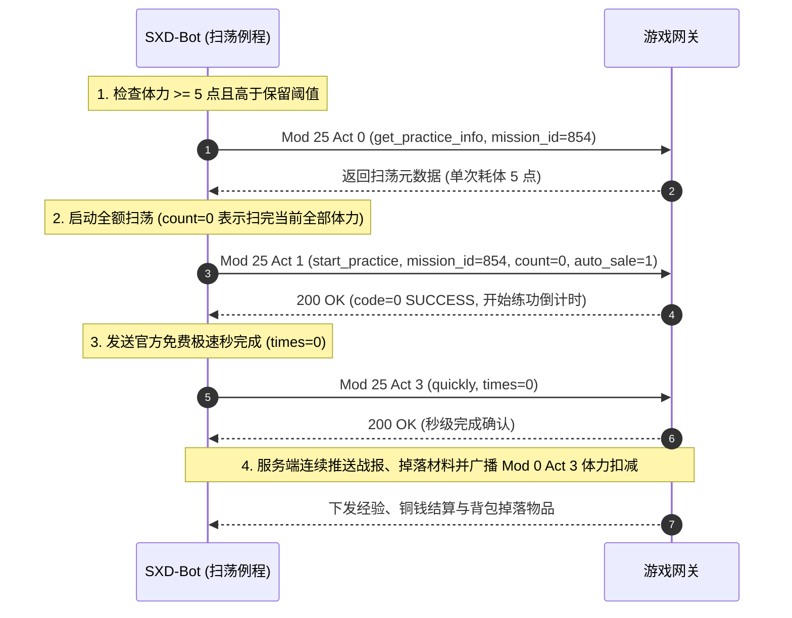

# 战斗与副本挑战全系模块精修规范与代码契约 (Mission, Sweep, SuperSport, WorldBoss)

> **文档状态**：已冻结 (Frozen)  
> **涵盖模块**：Mod 4 (`Mission` 普通副本剧情), Mod 25 (`MissionPractice` 副本练功秒扫荡), Mod 28 (`SuperSport` 竞技场天梯), Mod 24 (`WorldBoss` 世界Boss定时活动)  
> **安全防护级别**：包含 `[SAFE_READ]`, `[ROUTINE_FREE]`, `[HAZARDOUS_INGOT]` 三级红线标注  
> **关联工单**：[Ticket 5: 战斗与副本挑战全系模块精修规范与代码契约](https://github.com/atengk/sxd-bot/issues/6)  
> **上游规约**：[00_binary_framing_and_codecs.md](./00_binary_framing_and_codecs.md) | [01_micro_client_architecture_and_relay.md](./01_micro_client_architecture_and_relay.md) | [02_protocol_index_catalog.md](./02_protocol_index_catalog.md) | [03_core_cornerstone_modules.md](./03_core_cornerstone_modules.md)

---

## 1. 战斗挑战体系安全红线与资源调度准则 (Combat Guardrails)

在自动化战斗流水线中，战斗行为直接关联角色两大不可逆核心资产：**体力 (Power)** 与 **元宝 (Ingot)**。协议契约设计必须遵从严格的防御性编程规范：

1. **体力前置卫语句阈值防御**：
   - 副本挑战与扫荡每次单挑固定消耗 **5 点体力**；
   - 执行前必须检查 `ctx.player.power >= 5` 以及用户设定的最低保留体力阈值（`min_power_reserve`），体力不足时立即返回 `TaskResult.skipped`，严禁向服务端频繁抛送必然失败的畸形请求；
2. **零元宝挑战与清除 CD 绝对熔断 (`[HAZARDOUS_INGOT]`)**：
   - 竞技场默认每天提供 15 次免费挑战，世界 Boss 每次阵亡提供 30 秒冷却倒计时；
   - 官方协议提供了 `buy_challenge_times`（元宝购买竞技场次数）、`clear_cd_time`（元宝秒清竞技场冷却）、`ingot_inspire`（元宝直接鼓舞战力 +100%）、`ingot_relive`（元宝立即满血复活）；
   - **代码契约层必须将上述所有动作显式标记为 `[HAZARDOUS_INGOT]`，并在构造方法中强制断言 `allow_ingot: bool = False`**，默认调用时一律抛出安全熔断异常，绝不允许任何自动化任务意外消耗元宝。

---

## 2. 模块 4：Mod_Mission_Base (普通副本与剧情闯关)

`Mod_Mission_Base` (Module ID: `4`) 控制游戏的主线普通副本关卡、区域章节进度、怪物战斗与战后战利品结算。

### 2.1 核心动作契约一览

| 动作 ID (`Act`) | 动作名称 | 安全等级 | 核心职责与业务定义 |
| :--- | :--- | :--- | :--- |
| **`0`** | `get_sections` | `[SAFE_READ]` | 查询指定城镇包含的主线关卡章节列表与通关星级 |
| **`1`** | `enter_mission` | `[ROUTINE_FREE]` | 进入指定关卡场景，下发怪兽波次与首领属性 |
| **`2`** | `fight_monster` | `[ROUTINE_FREE]` | 发起怪物战斗，消耗 5 点体力并下发战斗战报与战利品 |
| **`4`** | `open_box` | `[ROUTINE_FREE]` | 通关副本后开启免费宝箱获取额外材料掉落 |
| **`15`** | `rank_info` | `[SAFE_READ]` | 查询关卡通关评分排行榜 |

---

### 2.2 动作详解与结构定义

#### Act 1: `enter_mission` (进入副本关卡)
- **请求字段**：`[IntUtil: mission_id]` (关卡编号，如 854 幽冥地府-白无常)
- **应答格式**：
  `[UByteUtil: result_code, IntUtil: mission_id, IntUtil: town_id, List[Record: monster_list]]`
  - `result_code`: 0=SUCCESS, 1=NOT_ENOUGH_POWER (体力不足), 2=BAG_FULL (背包已满)

#### Act 2: `fight_monster` (怪物战斗结算)
- **请求字段**：`[IntUtil: mission_id, IntUtil: monster_team_id]`
- **应答格式**：
  `[UByteUtil: result_code, UByteUtil: is_win, LongUtil: exp_gain, IntUtil: coins_gain, IntUtil: skill_gain, List[Record: drops]]`
  - `is_win`: 1=胜利，0=失败
  - `drops`: 掉落物品清单（包含物品模板 ID、强化等级、拾取状态）

---

## 3. 模块 25：Mod_MissionPractice_Base (副本练功与极速秒扫荡)

`Mod_MissionPractice_Base` (Module ID: `25`) 负责对已三星通关的副本关卡进行批量离线练功扫荡，是日常消耗自然恢复体力换取经验与装备图纸的核心通道。

### 3.1 核心动作契约一览

| 动作 ID (`Act`) | 动作名称 | 安全等级 | 核心职责与业务定义 |
| :--- | :--- | :--- | :--- |
| **`0`** | `get_practice_info` | `[SAFE_READ]` | 查询当前正在进行的关卡扫荡状态与剩余倒计时 |
| **`1`** | `start_practice` | `[ROUTINE_FREE]` | 启动全额/定量关卡扫荡，扣除体力并进入练功状态 |
| **`2`** | `cancel_practice` | `[ROUTINE_FREE]` | 中途取消练功扫荡，退回未开始轮次的剩余体力 |
| **`3`** | `quickly` | `[ROUTINE_FREE]` | **免元宝极速秒完成**：官方微端特权，秒级直接完成所有扫荡战斗并结算奖励 |
| **`8`** | `practice_notify` | `[SAFE_READ]` | 扫荡单轮完成或全量完成下行推送通知 |

---

### 3.2 极速秒扫荡最佳实践时序



---

## 4. 模块 28：Mod_SuperSport_Base (竞技场天梯冲榜)

`Mod_SuperSport_Base` (Module ID: `28`) 承载游戏经典 PVP 竞技场系统，每日提供 15 次免费挑战机会，产出巨额角色声望（Fame）与排名银币奖励。

### 4.1 核心动作契约一览

| 动作 ID (`Act`) | 动作名称 | 安全等级 | 核心职责与业务定义 |
| :--- | :--- | :--- | :--- |
| **`0`** | `open_super_sport` | `[SAFE_READ]` | 打开竞技场主面板，获取当前排名、积分与连胜场次 |
| **`1`** | `get_challenge_list` | `[SAFE_READ]` | 拉取当前可挑战的 5 位对手列表（包含对手排名、战力、职业） |
| **`2`** | `start_challenge` | `[ROUTINE_FREE]` | 向指定对手发起战斗，结算声望奖励并下发战报（176 字节） |
| **`3`** | `clear_cd_time` | `[HAZARDOUS_INGOT]` | **高危**：消耗元宝清除挑战失败后的冷却倒计时 |
| **`4`** | `buy_challenge_times`| `[HAZARDOUS_INGOT]` | **高危**：消耗元宝购买额外的竞技场挑战次数 |
| **`13`** | `get_challenge_times`| `[SAFE_READ]` | 查询当前剩余可用免费挑战次数（官方标准前置卫语句） |

---

### 4.2 软柿子智能筛选匹配算法

为确保 15 次免费挑战胜率最大化，自动化模块在解析 `get_challenge_list`（Act 1）下发的 5 位候选对手时采用**软柿子优先策略**：
1. **排名优先过滤**：候选人中筛选出 `ranking < my_ranking`（排名高于我方）的目标，以实现挑战获胜后直接跃升至对手排名；
2. **战力安全裕度**：在排名优于我方的候选人中，寻找 `combat_power < my_combat_power * 0.9` 的目标作为第一顺位；
3. **保底兜底**：若全部排名高于我方的对手战力均过高，则选择排名最靠后且战力最低的对手进行挑战，稳拿 10 点声望与保底铜钱。

---

## 5. 模块 24：Mod_WorldBoss_Base (世界 Boss 定时参战)

`Mod_WorldBoss_Base` (Module ID: `24`) 控制每日上午 10:00 与下午 15:30 开放的巨型全服首领活动（擎天木、赤炎兽、刀疤兔）。

### 5.1 核心动作契约一览

| 动作 ID (`Act`) | 动作名称 | 安全等级 | 核心职责与业务定义 |
| :--- | :--- | :--- | :--- |
| **`0`** | `get_world_boss_list` | `[SAFE_READ]` | 查询当日全部世界 Boss 开放时间表与状态 |
| **`1`** | `get_world_boss_data` | `[SAFE_READ]` | 进入战场，拉取当前 Boss 当前生命值、最大生命值与伤害排行榜 |
| **`2`** | `fight_world_boss` | `[ROUTINE_FREE]` | 向世界 Boss 发起一次攻击，获得伤害奖励结算并进入阵亡冷却 |
| **`4`** | `inspire` | `[ROUTINE_FREE]` | **阅历免费鼓舞**：消耗角色阅历提升攻击力 (+10% ~ +100%) |
| **`5`** | `ingot_inspire` | `[HAZARDOUS_INGOT]` | **高危**：消耗元宝 100% 成功直接鼓舞攻击力 |
| **`9`** | `clear_death_cd` | `[HAZARDOUS_INGOT]` | **高危**：消耗元宝立即复活，秒清 30 秒死亡冷却 |
| **`15`** | `auto_fight_set` | `[ROUTINE_FREE]` | 开启或配置客户端挂机自动参战设置 |

---

## 6. 二次开发使用示例

```python
from protocol.messages.battle import (
    MissionPracticeStartReq,
    MissionPracticeQuicklyReq,
    SuperSportStartChallengeReq,
    SuperSportBuyChallengeTimesReq,
    WorldBossFightReq,
    WorldBossInspireReq,
)

# 1. 启动普通副本极速扫荡 (零风险例行)
start_sweep = MissionPracticeStartReq(mission_id=854, count=0, auto_sale=1)
client.send_packet(start_sweep)
quick_sweep = MissionPracticeQuicklyReq(times=0)
client.send_packet(quick_sweep)

# 2. 发起竞技场挑战 (零风险例行)
challenge_pkt = SuperSportStartChallengeReq(player_id=1034)
client.send_packet(challenge_pkt)

# 3. 购买额外挑战次数 (元宝高危 - 前置拦截防护)
try:
    danger_pkt = SuperSportBuyChallengeTimesReq(times=5) # 默认 allow_ingot=False
except PermissionError as exc:
    logger.info("成功拦截未授权的元宝扣除操作: %s", exc)
```
