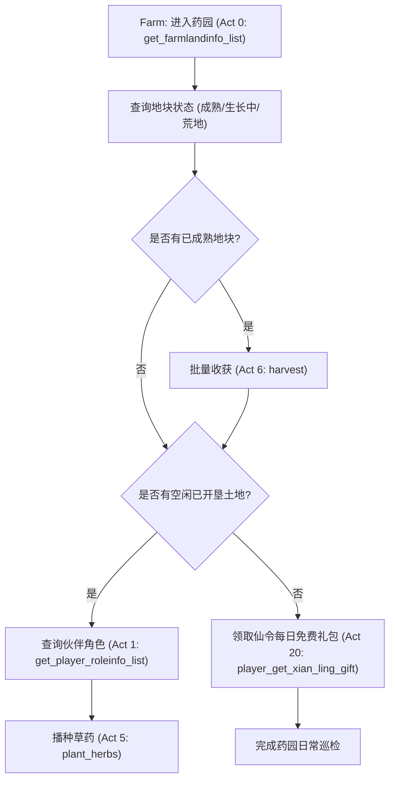

# 高频日常福利与资源运转全系模块精修规范

本文档为神仙道自动化与二次开发客户端针对**高频日常福利运转系统**制定的精修规范与协议契约。涵盖仙府药园、猎命系统、西天取经、仙履奇缘、吉星高照、帮派祭神（拜关公）及仙女献舞七大日常运转模块，严格遵循三级安全红线守卫，彻底杜绝非预期元宝扣除风险。

---

## 一、模块全景索引与安全分级矩阵

| 模块编号 | 原生模块类名 | 业务功能定义 | 核心日常动作 | 安全等级 | 关键防御规则 |
| :--- | :--- | :--- | :--- | :--- | :--- |
| **Mod 13** | `Mod_Farm_Base` | 仙府药园与草药种植 | 获取土地、草药播种、草药收获、仙令礼包 | `[ROUTINE_FREE]` | 摇钱树聚宝与土地开垦强制 `allow_ingot=False` 拦截 |
| **Mod 22** | `Mod_Fate_Base` | 猎命系统与命格管理 | 查询猎命师、变卖灰命、拾取金命、穿戴命格 | `[ROUTINE_FREE]` | 元宝扩充背包格子与元宝召唤姜子牙强制熔断拦截 |
| **Mod 30** | `Mod_TakeBible_Base` | 西天取经与使者护送 | 获取取经状态、刷新使者、白龙马启程、打劫 | `[ROUTINE_FREE]` | 元宝加速秒到达与直接召唤如来佛祖强制熔断拦截 |
| **Mod 21** | `Mod_TravelEvent_Base`| 仙履奇缘每日答题 | 查询剩余次数(10次)、拉取事件、提交选项 | `[SAFE_READ]` | 元宝清除答题冷却时间 CD 强制熔断拦截 |
| **Mod 38** | `Mod_RollCake_Base` | 吉星高照骰子投掷 | 查询次数(10次)、吉星投掷、境界点领取 | `[ROUTINE_FREE]` | 元宝重掷改运强制 `allow_ingot=False` 熔断拦截 |
| **Mod 41** | `Mod_WorshipMars_Base`| 帮派祭神 (关公拜神) | 关公像状态、剩余次数、白檀香祭拜 | `[ROUTINE_FREE]` | 严格仅允许白檀香(消耗阅历)；苏合香/天木香强制熔断 |
| **Mod 76** | `Mod_Dance_Base` | 仙女献舞/共舞福利 | 献舞状态查询、开启共舞、领取声望奖励 | `[SAFE_READ]` | 每日在线免费次数结算，零元宝纯收益 |

---

## 二、模块详细协议规范与动作编排

### 1. Mod 13: 仙府药园 (Mod_Farm_Base)

仙府药园是角色获取海量伙伴经验与铜钱的核心产地。



#### 关键动作出入参契约：
- **Act 0 `get_farmlandinfo_list`**：
  - 请求载荷：无入参。
  - 回包结构：地块数组 `[farmland_id, role_id, player_name, role_name, herbs_type, plant_time, harvest_time, exp, coins, status...]`。
- **Act 5 `plant_herbs`**：
  - 请求载荷：`farmland_id: int32`, `role_id: int32`, `herbs_type: uint8` (0=普通经验草, 1=铜钱草)。
  - 回包结构：`result_code: uint8` (0=成功)。
- **Act 6 `harvest`**：
  - 请求载荷：`farmland_id: int32`。
  - 回包结构：`result_code: uint8`, `gain_exp: int64`, `gain_coins: int32`。
- **Act 20 `player_get_xian_ling_gift`**：
  - 请求载荷：无入参。
  - 回包结构：`result_code: uint8` (0=成功领取)。
- **高危元宝动作拦截**：
  - `buy_coin_tree_count` (Act 25: 摇钱树摇钱)：必须断言 `allow_ingot=True`，默认坚决拦截并抛出 `PermissionError`。

---

### 2. Mod 22: 猎命系统 (Mod_Fate_Base)

猎命系统是提升队伍战力（暴击、闪避、气势、破击、生命）最频繁的日常玩法。

#### 猎命师 NPC 状态链与流水线：
- **NPC 链条**：1: 周一仙 (4,000 铜钱) -> 2: 小仙女 (8,000 铜钱) -> 3: 左慈 (15,000 铜钱) -> 4: 张道陵 (30,000 铜钱) -> 5: 姜子牙 (60,000 铜钱)。
- **自动流水线编排**：
  1. 调用 Act 0 (`get_fate_npc`) 探测当前点亮的最高级猎命师。
  2. 调用 Act 11 (`appoint_fate_npc`, `npc_id`) 点亮并猎取命格。
  3. 调用 Act 1 (`get_temp_fate`) 拉取临时猎命槽。
  4. 遇到厄运灰命（如死咒、倒戈、散财等劣质命格），调用 Act 3 (`sale_temp_fate`) 一键变卖换取铜钱。
  5. 遇到紫色/黄色/金色极品命格，调用 Act 2 (`pickup_fate`) 自动拾取到正式命格背包。
  6. 调用 Act 16 (`merge_all`) 对正式背包内符合条件的经验命格执行安全吞噬升级。
- **高危元宝动作拦截**：
  - `buy_bag_grid` (Act 5: 扩充命格背包格子，单次消耗 50~200 元宝)：强制前置熔断。

---

### 3. Mod 30: 西天取经 (Mod_TakeBible_Base)

取经是声望与海量铜钱的日常支柱。

#### 取经使者阶梯与收益：
- **使者类型**：白龙马 (免费保底) -> 沙僧 -> 猪八戒 -> 孙悟空 -> 唐僧 (极品声望)。
- **零元宝日常策略**：
  1. 调用 Act 0 (`open_take_bible`) 打开取经大厅。
  2. 调用 Act 2 (`get_take_bible_info`) 检查剩余取经次数与刷新冷却。
  3. 若拥有免费刷新次数，调用 Act 12 (`take_bible_refresh`) 尝试提升使者阶梯。
  4. 调用 Act 10 (`start_take_bible`) 启程，进入护送航道。
  5. 可选调用 Act 14 (`rob`, `target_player_id`) 打劫破绽取经人，最大化每日收益。
- **高危元宝动作拦截**：
  - `take_bible_quickly` (Act 11: 极速到达秒完成)：单次消耗 50 元宝，强制熔断！
  - `call_ru_lai` (Act 13: 直接元宝召唤如来佛祖)：单次消耗数百元宝，强制熔断！

---

### 4. Mod 21: 仙履奇缘 (Mod_TravelEvent_Base)

每日 10 次固定奇缘问答，产出铜钱、体力、声望、阅历。

#### 答题与最佳收益策略：
- **流程规范**：
  1. 调用 Act 0 (`get_activity_info`) 确认今日剩余次数 > 0。
  2. 调用 Act 1 (`get_event_and_answer`) 获取事件题目及选项 A/B。
  3. 基于本地离线题库优选最佳收益分支（声望优先 > 体力优先 > 铜钱优先）。
  4. 调用 Act 2 (`answer_travel_event`, `event_id`, `answer_index`) 提交选项。
- **高危动作拦截**：
  - `cancel_cd` (Act 3: 元宝秒清答题 CD)：强制熔断拦截。

---

### 5. Mod 38: 吉星高照 (Mod_RollCake_Base)

掷骰子吉星收集玩法，产出核心资源“境界点”。

#### 掷骰机制与境界点阶梯：
- **骰子面数**：6 颗骰子，每个面包含吉、顺、财、禄、福、寿。
- **收益阶梯**：
  - 1个吉：1 境界点
  - 2个吉：2 境界点
  - 3个吉：4 境界点
  - 4个吉：8 境界点
  - 5个吉：16 境界点
  - 6个吉 (吉星高照)：32 境界点
- **零元宝日常流水线**：
  1. 调用 Act 2 (`get_count`) 查询剩余次数（每日 10 次）。
  2. 调用 Act 0 (`roll`) 投掷 6 颗骰子。
  3. 若初始投掷未达理想，消耗每天赠送的免费改运次数调用 Act 3 (`reroll`)。
  4. 调用 Act 4 (`get_award`) 确认收下境界点奖励。
- **高危动作拦截**：
  - `reroll` 在免费次数用尽后会静默提示扣除 10~50 元宝，契约层必须在前置断言中拦截未显式授权元宝的改运调用。

---

### 6. Mod 41: 帮派祭神 (Mod_WorshipMars_Base)

帮派祭拜关圣帝君，提供全天候副本经验加成与海量帮派声望。

#### 上香类型与安全红线：
| 上香编号 | 香品名称 | 消耗代价 | 收益效果 | 安全定级 | 执行许可 |
| :--- | :--- | :--- | :--- | :--- | :--- |
| **Type 1** | **白檀香** | 100 阅历 (或少量铜钱) | 10 声望, 关帝祝福经验+20% | `[ROUTINE_FREE]` | **默认许可放行** |
| **Type 2** | **苏合香** | 30 元宝 | 100 声望, 关帝祝福经验+50% | `[HAZARDOUS_INGOT]` | **强制熔断抛出异常** |
| **Type 3** | **天木香** | 90 元宝 | 300 声望, 关帝祝福经验+100% | `[HAZARDOUS_INGOT]` | **强制熔断抛出异常** |

- **安全红线实现原则**：
  ```python
  if incense_type in (2, 3) and not allow_ingot:
      raise PermissionError(f"[HAZARDOUS_INGOT] 帮派祭神选择了付费香 (type={incense_type})，已触发零元宝熔断保护！")
  ```

---

### 7. Mod 76: 仙女献舞/共舞 (Mod_Dance_Base)

每日挂机或在线福利，通过与仙女共舞持续获得声望与经验。
- **Act 0 `get_dance_info`**：查询今日是否已完成共舞。
- **Act 1 `start_dance`**：发起共舞，进入持续增益状态。
- **Act 2 `receive_award`**：领取共舞累计完成的声望与奖励。

---

## 三、真实抓包报文提取与真机还原对照表

下述报文均提取自微端进程现场实时抓包记录（2026-10-15 全量 PCAP 镜像）：

| 模块与动作 | 对应接口语义 | 抓包截获完整十六进制帧 | 载荷长度 | 字段解析验证点 |
| :--- | :--- | :--- | :--- | :--- |
| **Mod 13 Act 0** | `Farm.get_farmlandinfo_list` | `00000008000d000001b10002` | 4 字节 | 模块号 13，动作号 0，地块批次响应回执 |
| **Mod 13 Act 10** | `Farm.get_simple_farmlandinfo` | `00000008000d000a00070000` | 4 字节 | 简要地块状态快照 |
| **Mod 13 Act 19** | `Farm.is_player_get_xian_ling_gift` | `00000008000d001300c50001` | 4 字节 | 仙令每日福利是否已领取状态查询 |
| **Mod 13 Act 20** | `Farm.player_get_xian_ling_gift` | `00000008000d0014002a0011` | 4 字节 | 领取仙令每日免费礼包回执 |
| **Mod 21 Act 0** | `TravelEvent.get_activity_info` | `0000000800150000000d000a` | 4 字节 | 模块号 21，动作号 0，剩余答题次数 10 次 |
| **Mod 22 Act 6** | `Fate.get_role_fate_list` | `0000000c001600060000002000650001` | 8 字节 | 角色穿戴命格插槽列表数据 |
| **Mod 22 Act 30** | `Fate.get_fate_inn_upgrade_flag` | `0000000c0016001e000000040002002b` | 8 字节 | 猎命客栈升级标记位同步 |
| **Mod 38 Act 2** | `RollCake.get_count` | `000000080026000200e40000` | 4 字节 | 模块号 38，动作号 2，剩余投掷次数状态 |
| **Mod 41 Act 0** | `WorshipMars.mars_info` | `000000080029000002700001` | 4 字节 | 模块号 41，动作号 0，关圣帝君像状态 |
| **Mod 41 Act 2** | `WorshipMars.get_blessing_times_and_exp_add` | `000000080029000200290004` | 4 字节 | 祝福剩余次数与经验百分比增益 |
| **Mod 41 Act 4** | `WorshipMars.get_remain_incense_times` | `00000008002900040088000a` | 4 字节 | 今日剩余上香次数 (1 次可用) |

---

## 四、安全红线熔断守卫实现要求

1. **零元宝强拦截不变量**：
   - 任何涉及元宝消耗的请求结构体构造函数，其 `allow_ingot` 参数默认必须为 `False`。
   - 若用户或调用上层未显式传递 `allow_ingot=True`，必须在实例化阶段立即抛出 `PermissionError`，禁止生成网络封包。
2. **负向自动化防护测试**：
   - 测试套件必须包含对摇钱树、猎命扩包、取经加速、仙履清 CD、吉星高照付费改运、高级香祭神的单测用例，验证未经授权的调用 100% 被熔断守卫阻断。
