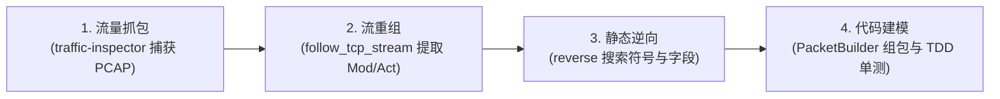

# 协议逆向与流量嗅探 MCP 工具链实战指南 (Reverse & Traffic Inspection)

在开发神仙道无头协议自动化项目（SXD Bot）初期，为了彻底摆脱人工频繁切换外部桌面 GUI 软件（如 Wireshark、IDA Pro、Fiddler）的上下文割裂与低效，项目深度集成了两套专为 AI Agent 打造的 Agent-Native Model Context Protocol (MCP) 服务端，构建了“**抓包嗅探 ➔ 流重组提取 ➔ 静态逆向定位 ➔ 协议建模验证**”的自动化闭环工作流。

---

## 1. 核心 MCP 工具链概览

### 1.1 全栈流量嗅探与抓包：`mcp-server-traffic-inspector`

- **GitHub 仓库**：[https://github.com/atengk/mcp-server-traffic-inspector](https://github.com/atengk/mcp-server-traffic-inspector)
- **定位**：专为 AI Agent 打造的全栈网络流量抓包、会话检索、底层链路诊断、WebSocket 审计、TCP 重组、请求重放与规则 Mock 全功能 MCP Server。
- **运行方式**：`uvx --from atengk-mcp-server-traffic-inspector@1.3.0 atengk-mcp-server-traffic-inspector`
- **核心工具接口**：
  - `start_pcap_capture` / `stop_pcap_capture`：网卡级原始流量与 PCAP 捕获；
  - `list_tcp_streams` / `follow_tcp_stream`：TCP 会话重组与原始双向 Hex 报文追踪；
  - `start_http_capture` / `list_http_flows`：HTTP/HTTPS 代理与 Web 鉴权链分析；
  - `diagnose_network_session`：链路根因诊断与断连特征分析。

### 1.2 二进制逆向与反编译：`mcp-server-reverse`

- **GitHub 仓库**：[https://github.com/atengk/mcp-server-reverse](https://github.com/atengk/mcp-server-reverse)
- **定位**：专为 AI Agent 打造的跨平台二进制静态逆向分析与数字取证 MCP Server（原生支持 PE / ELF / Mach-O，内置 LIEF + Capstone + pefile 内核并按需挂载 radare2 / objdump / floss）。
- **运行方式**：`uvx --from atengk-mcp-server-reverse@1.2.0 atengk-mcp-server-reverse`
- **核心工具接口**：
  - `open_binary` / `close_session`：加载并解析二进制文件；
  - `search_strings` / `search_bytes_and_constants`：跨节区检索关键协议魔数、错误提示与 ActionScript 符号；
  - `disassemble` / `decompile_function`：汇编反编译与函数控制流分析；
  - `analyze_cfg` / `find_xrefs`：控制流图与交叉引用追踪。

---

## 2. 协议还原经典实战案例 (Case Studies)

### 2.1 案例一：Mod 184 心跳特征与 3 秒活性对齐

- **问题现象**：早期连接建立后约 15 秒，网关会无故抛出 EOF 切断 TCP 连接。
- **MCP 诊断过程**：
  1. 调用 `mcp_traffic-inspector_follow_tcp_stream` 追踪官方微端存活会话的 Hex 报文；
  2. 发现客户端每隔 3 秒向服务端发送一串固定的 8 字节短包：`00 00 00 04 00 b8 00 04`；
  3. 解读字段：前 4 字节为长度 `0x00000004`，后接 Mod `0x00b8` (十进制 184) 与 Act `0x0004` (十进制 4)；
  4. 上层落地为 [`tasks/routine/heartbeat.py`](../../tasks/routine/heartbeat.py)，以 3.0 秒周期持续对齐保活，彻底解决断线。

### 2.2 案例二：Mod 28 竞技场挑战与 176 字节战报秒回

- **逆向推导**：
  1. 通过 `mcp_reverse_search_strings` 在客户端 SWF/二进制中搜索关键词 `SuperSport`；
  2. 锁定模块编号为 `28`，动作号为 `Act 3` (打开)、`Act 4` (对手列表)、`Act 9` (发起挑战)；
  3. 挑战请求携带目标玩家 ID：`PacketBuilder(mod=28, act=9).write_int32(player_id).build()`；
  4. 随后调用 `mcp_traffic-inspector_follow_tcp_stream` 验证服务端回包，捕获到标准的 176 字节战报数据帧，确认战斗在服务端即时计算完毕并下发声望奖励。

### 2.3 案例三：Mod 52 非法主动发包网关熔断排查

- **问题现象**：尝试对 Mod 52 (在线时长与俸禄) 主动发包探测时，服务端直接切断连接。
- **诊断推导**：
  1. 利用 `mcp_traffic-inspector_diagnose_network_session` 分析 TCP 断开原因；
  2. 结合 `mcp_reverse_find_xrefs` 追踪 Mod 52 的调用链，确认该模块在官方客户端中仅为**被动场景状态监听包**，禁止客户端主动上行上报；
  3. 框架随即在 [`tasks/routine/online_gift.py`](../../tasks/routine/online_gift.py) 中将该模块调整为被动广播监听，规避了非法探针断连。

---

## 3. 标准协议逆向与开发 SOP (扩展新玩法四步法)

后续接手开发待办玩法（如**深海捕鱼**、**六道轮回塔**）时，推荐遵循以下 SOP：

1. **流量抓包**：使用 `start_pcap_capture` 捕获人工在微端中触发该玩法时的通信流量；
2. **流重组**：使用 `follow_tcp_stream` 查看上下行数据，确认 Mod 编号、Act 编号与载荷字节数；
3. **静态逆向**：在 `reverse` 中搜索对应的 ActionScript 类名（如 `Mod_Fish_Base`），确认请求字段的打包顺序（`int8`/`int32`/`string`）；
4. **代码建模**：使用 `PacketBuilder` 实现对应的 `BaseTask`，并追加单元测试保障安全。
